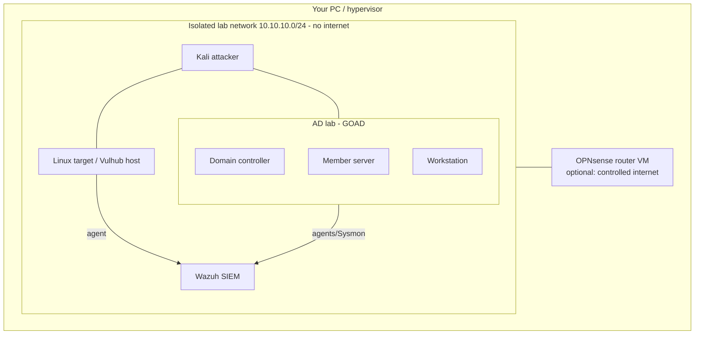

# Home lab

Every recipe ends with **Lab it**, and this is where that happens. Build it in stages; you don't
need everything on day one.

## Build order

| Stage | Roadmap level | Build | Page |
|---|---|---|---|
| 1 | L0 | Hypervisor, isolated network, Kali, one Linux VM, one Windows VM | [Hypervisor & network](hypervisor-and-network.md) |
| 2 | L2 | Wazuh SIEM + Sysmon on Windows, agent on Linux | [SIEM stack](siem-stack.md) |
| 3 | L2 | Docker host for DVWA, Juice Shop and Vulhub CVE environments | [Web & CVE targets](web-and-cve-targets.md) |
| 4 | L3 | GOAD Active Directory lab | [AD lab (GOAD)](ad-lab.md) |
| 5 | L4 | Atomic Red Team / Caldera for purple-team exercises | covered in [Purple team](../50-purple-team/index.md) |
| 6 | AI track | Ollama + Open WebUI + LiteLLM gateway + a toy MCP server | written in phase P6 |

## Hardware guide

| Lab size | RAM | Disk | Runs |
|---|---|---|---|
| Starter | 16 GB | 150 GB SSD | Kali + 1 Linux + 1 Windows, or the Docker targets |
| Standard | 32 GB | 300 GB SSD | Starter + Wazuh + GOAD-Light (3 VMs) |
| Full | 64 GB+ | 500 GB+ SSD | Full GOAD (5 VMs) + SIEM + attacker, all at once |

No big PC? Run one stage at a time and snapshot. Or use the free online labs in the
[catalog](../resources/online-labs.md) for the parts that need more hardware.

## Golden rules

1. **Isolation:** lab VMs sit on a host-only or internal network. Only connect a VM to NAT
   temporarily, for updates, and never the deliberately vulnerable ones.
2. **Snapshots:** take one clean snapshot per VM before every exercise, and revert afterwards.
3. **No real data or credentials** anywhere in the lab.
4. **Evaluation licences:** Microsoft's free evaluation ISOs (Windows Server 180 days,
   Windows 11 Enterprise 90 days) are fine for a lab. Rebuild them when they expire.

See also [Ethics & legal](../ethics-and-legal.md).
