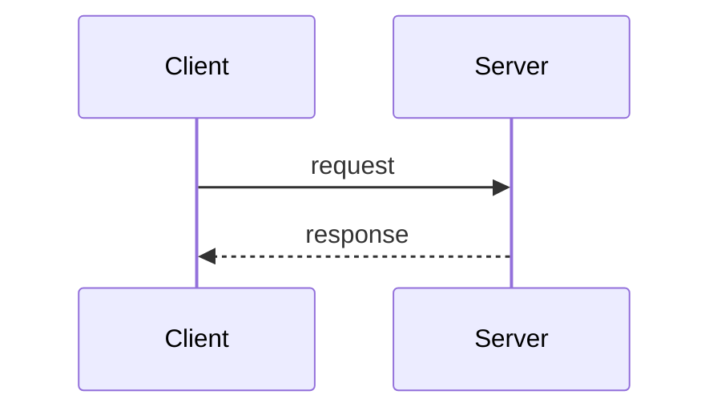

# Recipe template (topic note)

Copy this into a section folder as `kebab-case-topic.md`. Keep every heading. Write "n/a" and say
why if a section doesn't apply.

````markdown
# <Topic name>

**Level:** L? · **Platforms:** Linux / Windows · **ATT&CK:** [T????](https://attack.mitre.org/techniques/T????/) · **Lab:** <lab name>

## What & why
One paragraph: what it is, why attackers and defenders both care, and where it sits in the roadmap.

## How it works
The mechanics. Add a diagram if it helps:



## Linux / Windows

=== "Linux"

    ```bash
    # inspect / configure / enumerate
    ```

=== "Windows"

    ```powershell
    # inspect / configure / enumerate
    ```

## Red view
- How it is abused, and what the attacker needs first (privilege, access, network position)
- Tools commonly used (link to the tool's docs and the [catalog](../resources/index.md))
- ATT&CK: technique and sub-technique IDs

## Blue view
- **Artifacts:** event IDs, log files, registry keys, network traces it leaves
- **Detection:** a Sigma rule or SIEM query (point to SigmaHQ if one exists)
- **Prevention / hardening:** the config change that stops or limits it
- **D3FEND:** the countermeasure ID if one applies

## Lab it
1. Lab: <name> (link to its catalog entry)
2. Steps: the attack side
3. Steps: the detection side. Show the alert or log line you got.

## Check yourself
1. …
2. …
3. …

## Go deeper
- <resource> - why it is worth reading
````
