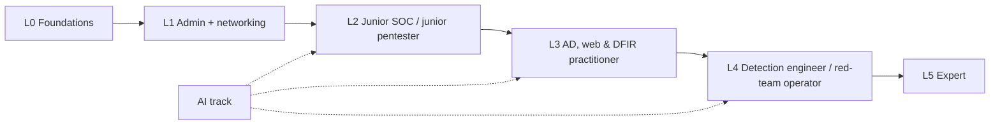

# Roadmap: L0 → L5

Work through the levels in order. Each level has **notes to study**, **labs to finish**, and
a **capstone** that proves the level. Red and blue run side by side: at every level you
attack something *and* detect it.

!!! tip "Pace"
    Roughly 1–3 months per level at 8–10 hours a week. Don't skip the capstones; they
    are where the notes turn into skill.

## L0: Foundations

- **Study:** [Foundations](00-foundations/index.md): networking (OSI/TCP/IP, subnetting, DNS,
  HTTP), how an OS works, the Linux shell, Windows basics, Bash/Python/PowerShell, crypto basics,
  virtualization.
- **Labs:** OverTheWire *Bandit* 0–20, picoCTF general skills, Linux Journey, TryHackMe free
  "pre-security" rooms 🟡.
- **Capstone:** build the [home lab](lab/index.md) base: hypervisor, isolated network, Kali VM,
  one Linux and one Windows VM that can ping each other but not the internet.

## L1: Linux & Windows admin + networking

- **Study:** [Linux](10-linux/index.md) admin, permissions, systemd, logging; [Windows](20-windows/index.md)
  internals, registry, services, PowerShell, event logs; Wireshark basics.
- **Labs:** Bandit to the end, OverTheWire *Natas* 0–10, PortSwigger Academy apprentice labs,
  Malware-Traffic-Analysis beginner PCAPs.
- **Capstone:** write a Bash script and a PowerShell script that each collect a host's users,
  services, listening ports and scheduled tasks into a report. These become your first IR triage
  tools.

## L2: Junior SOC analyst / junior pentester

- **Red:** methodology, recon/OSINT, scanning, the OWASP Top 10, Linux and Windows privesc
  ([Red team](30-red-team/index.md)).
- **Blue:** SOC workflow, deploy Wazuh, Sysmon, the alert triage process ([Blue team](40-blue-team/index.md)).
- **Labs:** DVWA, Juice Shop, Metasploitable 3, VulnHub easy boxes, HTB Starting Point 🟡,
  Blue Team Labs Online free challenges 🟡, LetsDefend free 🟡.
- **Capstone:** compromise Metasploitable 3 Windows in your lab **with Wazuh + Sysmon watching**,
  then write both a pentest report and an incident timeline of the same attack.

## L3: AD, web and DFIR practitioner

- **Red:** Kerberos/NTLM, AD attack paths (BloodHound-style graph thinking), web deep dives,
  pivoting.
- **Blue:** detection engineering with Sigma, threat hunting, memory & disk forensics,
  Velociraptor, Zeek/Suricata.
- **Labs:** [GOAD](lab/ad-lab.md), PortSwigger practitioner labs, Vulhub CVE environments, OTRF
  Security-Datasets, EVTX-ATTACK-SAMPLES, CyberDefenders free labs 🟡, flAWS 1 & 2.
- **Capstone:** take GOAD from a low-privilege user to Domain Admin, then write a Sigma rule for
  each step and prove that it fires on the replay.

## L4: Detection engineer / red-team operator

- **Red:** C2 concepts, OPSEC, ROP and basic exploit development, cloud and Kubernetes attacks.
- **Blue:** detection-as-code, ATT&CK coverage tracking, malware analysis (static and dynamic), threat intel.
- **Purple:** [emulate → detect → tune](50-purple-team/index.md) with Atomic Red Team and Caldera.
- **Labs:** Splunk Attack Range, BOTS v3, ROP Emporium, Exploit Education Phoenix, CloudGoat,
  Kubernetes Goat.
- **Capstone:** a purple-team exercise covering 20 ATT&CK techniques with an ATT&CK Navigator
  coverage layer from before and after.

## L5: Expert

- **Study:** [Specialties](70-specialties/index.md) (RE, heap exploitation, crypto attacks),
  [case studies](90-case-studies/index.md) written in your own words, the AI security track.
- **Labs:** how2heap, pwn.college advanced dojos, OST2 deep courses, reproducing CVEs in Vulhub
  and writing the detection for each.
- **Capstone:** publish a technical write-up: a root-cause analysis of a real CVE, or a new
  detection with its test data.

## AI track (parallel)

Start at L2 and grow with it: [how models work → using them → tools and MCP → restricting access →
AI security](80-ai/index.md). Capstone: a self-hosted AI gateway with per-user keys and model
allow-lists, attacked with garak and defended with guardrails.

## Cert syllabi as checklists (optional)

Free syllabi are useful for spotting gaps even if you never sit the exam: CompTIA Security+ / CySA+
exam objectives (free PDFs), and the published topic lists of well-known practical pentest and DFIR
certifications. Professor Messer's free Security+ videos are in the
[catalog](resources/courses.md).
